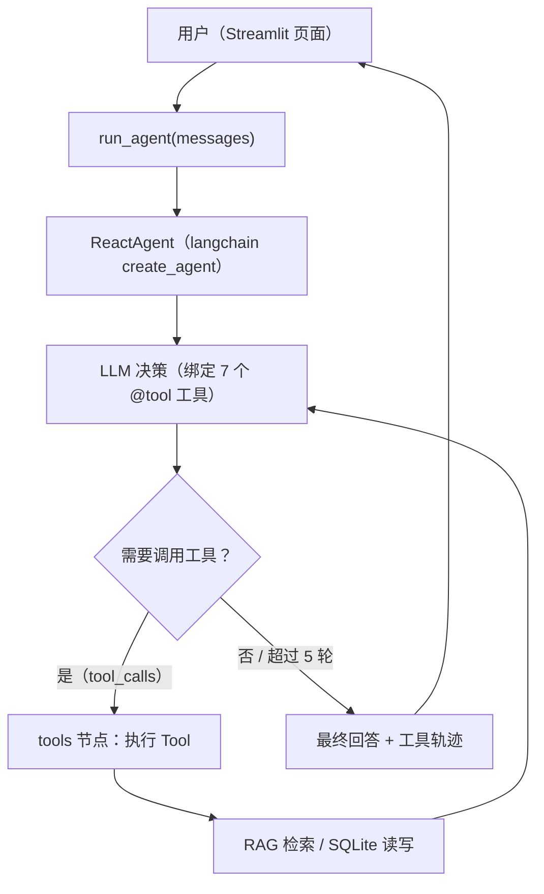
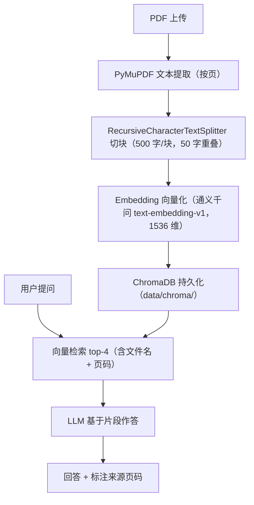

# StudyMate AI

> 基于 LLM + LangGraph + Tool Calling + RAG 构建的智能学习助手

StudyMate AI 是一个本地运行的 AI 学习助手：用户在浏览器里与 Agent 对话，即可制定学习计划、管理任务、上传 PDF 资料并基于资料进行问答。前端是 Streamlit（`app.py`），与后端 Python 模块同进程直连，一条命令即可启动。

当前版本是基础版本，重点在于完整实现 **AI Agent + Tool Calling + RAG** 这条主线：LangGraph 状态图驱动 LLM 自主决策调用 7 个工具，数据落 SQLite 持久化；知识问答通过本地向量库检索用户上传的 PDF，并标注到页的来源——资料里没有的内容，明确拒绝编造。

## ✨ 核心功能

- 🤖 **AI 学习对话** — 多轮对话，Markdown 渲染，工具调用轨迹可视化，会话历史持久化（切换 / 删除 / 刷新恢复）
- 🧠 **LangChain Agent** — `create_agent`（LangGraph 驱动）组织 `agent ⇄ tools` 循环，中间件实现轮次上限 5 防死循环与工具执行监控日志，单轮可编排多个工具
- 🔧 **Tool Calling** — 7 个工具：创建 / 查询学习计划、创建 / 完成任务、读取学习记录、获取统计、知识库检索
- 📚 **RAG 知识库** — 语义检索上传的资料，基于原文片段作答并标注「资料来源：《xxx》第 X 页」
- 📄 **PDF 上传与解析** — PyMuPDF 按页提取，langchain 分片器切块（500 字/块、50 字重叠），后台入库
- 📝 **AI 学习计划** — 阶段可由 LLM 设计或自动均分为 4 阶段，通过 AI 对话创建
- ✅ **学习任务管理** — 创建 / 完成 / 删除 / 状态筛选，跨对话通过学习记录中的任务 `#id` 闭环
- 📊 **学习记录与统计** — 学习天数、完成率、最近动态
- 💾 **SQLite 数据持久化** — 7 张表（计划 / 任务 / 记录 / 会话 / 消息 / 文档 / 用户），ChromaDB 向量落盘

## 🤖 Agent 工作流程



Agent 是 StudyMate AI 的核心决策层：LLM 根据用户意图自行判断该调用哪个（哪些）工具——说"制定 30 天学习计划"就写数据库，问"教材怎么说 AVL 树"就检索向量库——工具结果回填状态后再次交给 LLM，直到能给出最终回答。前端会把每一步工具调用轨迹展示出来。

## 📚 RAG 知识库



RAG 让 StudyMate AI 基于用户自己上传的学习资料回答问题，而不是完全依赖模型自身知识：检索不到相关内容时会如实说明，不会编造。

## 🛠️ 技术栈

### AI / Agent
- LLM（OpenAI 兼容接口）
- LangChain（create_agent + @tool + middleware）
- LangGraph（create_agent 执行引擎）
- Tool Calling

### RAG
- PyMuPDF
- langchain-chroma + RecursiveCharacterTextSplitter
- Embedding（通义千问 DashScope text-embedding-v1，1536 维，需 `DASHSCOPE_API_KEY`）
- ChromaDB

### Database
- SQLite
- SQLAlchemy

### Frontend
- Streamlit（入口 `app.py`，6 个页面，直连后端 Python 模块）

## 📁 项目结构

```
StudyMate/
├── app.py               # ★ Streamlit 前端入口（streamlit run app.py，6 个页面）
├── agent/               # ReactAgent（create_agent）：react_agent.py + tools/（7 个 @tool 工具、中间件）
├── model/               # 模型工厂：factory.py（ChatModel / Embeddings，延迟构造）
├── rag/                 # RAG：vector_store.py（langchain-chroma）/ rag_service.py / backfill.py
├── database/            # models.py（7 张表）/ db.py / repo.py（数据访问层）
├── utils/               # 通用工具：path / logger / config / prompt_loader / file_handler
├── config/              # YAML 配置：rag / chroma / agent / prompts
├── prompts/             # 提示词：main_prompt.txt（Agent 系统提示词）
├── data/
│   ├── uploads/         # 上传的 PDF 原件
│   ├── chroma/          # ChromaDB 向量库
│   └── studymate.db     # SQLite 数据库
├── logs/                # 运行日志（自动生成）
├── .env.example         # 环境变量模板（真实 Key 只放 .env）
└── requirements.txt
```

## 🚀 快速开始

> 依赖 Python 3.10+，以下命令在项目根目录 `StudyMate/` 下执行（Windows）。

**1. 创建虚拟环境**

```bash
python -m venv .venv
```

**2. 安装依赖**

```bash
.venv\Scripts\activate
pip install -r requirements.txt
```

**3. 配置环境变量**

```bash
copy .env.example .env
```

编辑 `.env`，填入三项配置（见下节）。

**4. 启动项目**

```bash
streamlit run app.py
```

**5. 访问地址**

浏览器打开 **http://localhost:8501/**

启动时会自动建表、预置用户并回填未向量化的文档（均为幂等操作）。

## 🔐 环境变量

复制 `.env.example` 为 `.env` 后填写，LLM 三项 + Embedding 一项均为必填；缺失时 Streamlit 侧边栏会给出警告，对话时也会报错：

```env
LLM_API_KEY=your_api_key
LLM_BASE_URL=https://api.openai.com/v1
LLM_MODEL=gpt-4o-mini
DASHSCOPE_API_KEY=sk-your-dashscope-key
```

| 变量 | 说明 |
|---|---|
| `LLM_API_KEY` | OpenAI 兼容接口的 API Key |
| `LLM_BASE_URL` | 接口地址（DeepSeek / 通义千问 / Moonshot / MiMo 等均可） |
| `LLM_MODEL` | 模型名称 |
| `DASHSCOPE_API_KEY` | 阿里云 DashScope API Key（RAG 文本向量化用） |

> API Key 只放在 `.env`（已在 `.gitignore` 中），禁止硬编码进代码。
